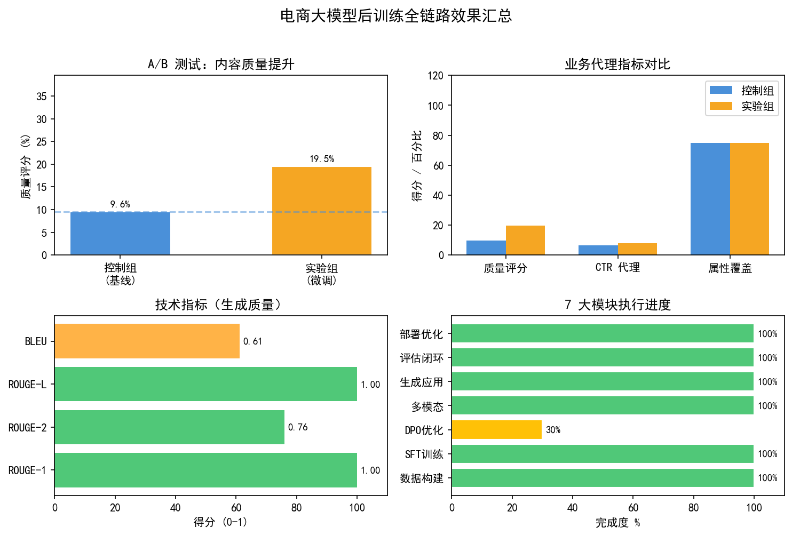

# nano-posttrain

A small PyTorch library for learning supervised fine-tuning (SFT), direct preference optimization (DPO), and LoRA. Prompt masking, sequence log-probabilities, reference-model CPU offload, training loops, and adapter serialization are implemented here.

The e-commerce application lives in the separate [ecom-posttrain](https://github.com/AMark-CS/ecom-posttrain) project. The old `ecommerce_project/` directory and application metrics do not belong in this core package.

## Verified execution results

Checked on **2026-10-20**, using Windows, Python 3.12.14, PyTorch 2.11.0+cu128, Transformers 5.19.0, and an NVIDIA GeForce RTX 3060. Model: `Qwen/Qwen2.5-0.5B`, loaded from cache. Both training checks used bfloat16, LoRA rank 16 / alpha 32 / dropout 0.05, maximum sequence length 128, batch size 1, gradient accumulation 1, seed 42, and two optimizer steps.

| Check | Actual result |
| --- | --- |
| Default tests | 13 passed, 1 failed, 3 skipped (2.44 seconds) |
| Opt-in real-model/tokenizer smoke tests | 3 passed (1.94 seconds), with 2 pytest plugin rewrite warnings |
| SFT, five toy examples | Two steps completed; logged losses 2.7812 and 1.4688; adapter saved |
| DPO, four toy triplets | Two steps completed with CPU reference; losses 0.7027 and 0.7157; logged preference accuracy 0.00 at both steps; adapter saved |
| LoRA | 169 wrapped linear modules; 11,243,520 trainable / 505,276,288 total parameters (2.23%) |

The failing test is `tests/test_data.py::test_sample_sft_json_loads`: it looks for `data/sample_sft.json`, while the file is now at `nano_posttrain/data/sample_sft.json`. This documentation update does not change the test or training implementation.

These short runs verify loading, loss computation, backward passes, and checkpoint writing. They do not demonstrate convergence, generation quality, or superiority over TRL. The first optimizer step has learning rate zero during warm-up; the two SFT losses come from different batches. DPO starts independently from the base model, without loading the SFT adapter. No GPU-memory or controlled inference benchmark was collected.

See [the verification record](docs/verification.md) for commands, environment details, and training logs. The old A100 timing table and sub-2.5-GB DPO claim were removed because no supporting artifacts are available.

### Results chart



Loss points are separate observed batches, not a convergence curve; SFT and DPO use different objective scales. Test suites ran separately. [Logs and chart inputs](docs/verification.md) and [the chart generator](docs/generate_readme_charts.py) are retained; rebuild with `python docs/generate_readme_charts.py` (Matplotlib required).

## Installation

Install a PyTorch build suitable for your device, then:

```bash
git clone https://github.com/AMark-CS/nano-posttrain.git
cd nano-posttrain
python -m pip install -e .
python -m pip install pytest
```

Python 3.10 or newer is declared in `pyproject.toml`; the environment above is the one verified here. Optional extras include `dev`, `trl`, `peft`, and `wandb`. The core uses its own LoRA implementation and does not require PEFT, TRL, Accelerate, or DeepSpeed.

## Reproduce the short training runs

Run from the repository root. Use new output directories when preserving previous checkpoints.

```bash
python -m nano_posttrain.cli.train_sft \
  --data_path nano_posttrain/data/sample_sft.json \
  --output_dir output/readme_sft --use_lora --max_steps 2 \
  --max_length 128 --per_device_batch_size 1 --grad_accum_steps 1 \
  --learning_rate 5e-5 --log_every 1 --no_wandb

python -m nano_posttrain.cli.train_dpo \
  --data_path nano_posttrain/data/sample_dpo.json \
  --output_dir output/readme_dpo --use_lora --ref_device cpu \
  --max_steps 2 --max_length 128 --max_prompt_length 64 \
  --per_device_batch_size 1 --grad_accum_steps 1 \
  --log_every 1 --no_wandb
```

Installed commands are `nano-sft`, `nano-dpo`, and `nano-eval`. For CPU-only training select `--dtype float32`; CPU training was not benchmarked here. The loop is bounded by both `num_epochs` and `max_steps`, so a larger step limit alone does not repeat a tiny dataset indefinitely.

SFT writes `output/readme_sft/step_latest/lora.pt`; DPO writes `output/readme_dpo/latest/lora.pt`. These are adapter-only checkpoints, not full Hugging Face model directories. Trainers overwrite their latest checkpoint and do not automatically resume optimizer state.

## Generate from the SFT adapter

```bash
python -m nano_posttrain.eval.eval_harness \
  --model_name Qwen/Qwen2.5-0.5B \
  --lora_path output/readme_sft/step_latest/lora.pt \
  --prompts "What is the capital of France?" --max_new_tokens 64
```

This is a qualitative generation tool, not a scored benchmark. Its default adapter settings match these runs. Custom LoRA settings require matching model construction when restoring the adapter. This command was inspected but not executed during documentation verification.

## How the core works

- **SFT:** render prompt prefixes and complete conversations using the chat template, mask prompt labels with `-100`, right-pad batches, and apply shifted cross-entropy.
- **DPO:** tokenize prompt/chosen/rejected triplets, pad alternatives to one length, concatenate them for policy/reference forwards, and sum response-token log-probabilities.
- **Regularization:** `--gamma` adds chosen-response SFT loss to DPO.
- **CPU reference:** move input IDs to the frozen reference and sequence log-probabilities back to the policy device. Labels are aligned with logits before gathering. Speed/memory tradeoffs depend on the workload.
- **LoRA:** wrap linear modules with low-rank updates and train adapter parameters.

## Project layout

```text
nano_posttrain/
  cli/           SFT and DPO entry points
  data/          datasets, collators, sample JSON files
  losses/        SFT and DPO objectives
  models/        tokenizer, policy, frozen reference loaders
  optim/         LoRA wrapping and adapter export
  trainers/      single-device PyTorch loops
  eval/          qualitative generation harness
  utils/         logging and seeds
configs/         example configurations
scripts/         shell launchers and TRL comparison helper
tests/           unit tests and three opt-in smoke tests
docs/            architecture, memory notes, verification
```

Shell launchers still reference old module/data paths; use the package-qualified commands above. `scripts/compare_with_trl.py` is experimental: constructing the nano trainer builds it, then the script explicitly calls `_build()` again before `fit()`. It also assumes CUDA for memory-stat reset and emits wall time and peak memory without final loss. No fair TRL comparison was run or is claimed.

## Tests

### Interactive training hooks

Both trainers accept optional keyword-only `on_step` and `should_stop` callbacks. Existing constructor calls remain supported. `on_step` receives structured metrics after each actual optimizer update (`step`, `total_steps`, `loss`, `learning_rate`; DPO also reports preference accuracy and margin). `completed_steps` records actual updates. `should_stop` is checked before each micro-batch; stopping writes the latest adapter without applying unfinished accumulation. These callbacks support the local GPU lab without parsing log text.

Training now explicitly enters `model.train()` so configured LoRA dropout is effective. The local-lab regression run passed **16 CPU tests**, with **3 opt-in smoke tests skipped**; the stale sample-data test path noted in the earlier verification was corrected to the package's actual data location. The earlier chart remains a historical record of that earlier invocation.

The experiment application stores immutable adapter snapshots and full configuration separately; core checkpoints still do not provide automatic optimizer resume.

```bash
python -m pytest tests -q
python -m pytest tests/test_smoke.py -q --run-smoke
```

Default tests use small tensors and a stub tokenizer. Smoke tests load the real Qwen tokenizer/model and check shapes and LoRA wrapping; they do not run a training loop. The separate two-step CLI runs provide training execution evidence. First-time model access requires network access and disk space; cached runs can use `HF_HUB_OFFLINE=1`.

## Documentation and license

[Architecture](docs/architecture.md) · [DPO memory notes](docs/dpo_memory_tricks.md) · [Verification](docs/verification.md)

[Software engineering design review](docs/software_engineering_review.md): package boundaries, configuration, masking, checkpoint contracts, testing, and a prioritized improvement sequence using the Agent Skills workflow.

Apache 2.0; see [LICENSE](LICENSE).
